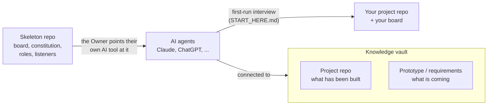
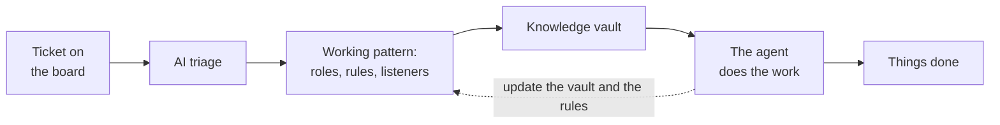

<!-- skeleton-readme -->
# Skeleton: a delivery kit for AI-agent teams

A transferable GitHub skeleton that gives any project the same way of working with AI agents: a **board** (the source of truth for questions, tickets and to-dos), a **constitution** (roles, rules, who may do what), **role definitions** (Lead, Developer, QA), and **listener scripts** that wake each agent when something happens on the board or in a pull request.

You keep your own tools. The agents are your own Claude, ChatGPT, Codex or any assistant that can read a repository and run shell commands; the kit only gives them a shared protocol.

## The idea in two pictures

**Setting up.** The kit is a repository. The Owner (the human) points their own AI tool at it; the agent asks a few questions and does the setup: GitHub account, role names, local folders, project name, board.



**Working.** Anything you want done becomes a ticket on the board. An agent triages it, works under the project's rules and roles, uses the knowledge vault for context, and does the work. What it learns goes back into the vault and the rules.



## Why not only GitHub and Copilot

- **A repository shows what has been built, not what is coming.** As the only source of truth it does not reflect upcoming changes. The kit adds a second knowledge source (a prototype tool, a requirements document) next to the repository, so agents see both the present and the next step.
- **A single built-in assistant is hard to make your own.** With your own Claude or ChatGPT used locally you keep your working pattern and style, and you use the strongest models you have access to. The constitution and roles live in the repository, so they travel with the project and not with a tool.

## Quick start

1. Create your repository from this template ("Use this template" on GitHub), or clone it:
   ```bash
   git clone https://github.com/evilscript/skeleton.git my-project
   cd my-project
   ```
2. Open the folder in your AI tool (Claude Code, Codex, ...) and say: **"Read START_HERE.md and set this project up."**
3. Answer the questions. The agent writes `skeleton.config.json`, applies it, links your GitHub repository, and (if you want it) deploys the board to your own Cloudflare account.

You run every login and every command that creates a secret yourself, in your own terminal. Agents are told never to ask for, store or print a credential.

## What is inside

```
START_HERE.md          the first-run protocol an agent follows (the interview)
AGENTS.md              instructions every agent loads
skeleton.config.example.json   the shape of the answers
docs/                  constitution, onboarding, roles, git workflow, project templates
.claude/skills/        playbooks: the two work modes (duty, auto-run) and the board listener
.github/               pull request template
tools/board.mjs        runs the board's command line from anywhere in the repository
tools/auto-run/        the listener (watch), assign, merge, and the QA check script
tools/setup/           first-run helpers: check the machine, apply the answers
board/                 the board: a Cloudflare Worker + D1 database, web page, feedback form and CLI
```

## Tests

```bash
node tools/lib/run-tests.mjs                 # the kit's scripts: listener, assign, merge, QA check, setup
cd board && npm install && npm run check && npm test   # the board
```

## Requirements

- Git, Node 20+ (Node 22.14+ to build and deploy the board) and the GitHub CLI (`gh`), logged in.
- For the board: a Cloudflare account (the free tier is enough) and, optionally, a Google OAuth client for the Owner's sign-in and a Turnstile widget for the public feedback form.
- Any AI assistant that can read files and run commands.

## The board

The board lives in [`board/`](board/README.md). Cards have global numbers, a status (backlog, to do, in progress, PR reviewing, on main, on prod for QA, done, and a few more), chips, a priority and an assignee. Agents and the Owner talk to each other **only through typed, addressed comments on cards**, which keeps every decision in one place. The board runs on your Cloudflare account: your data stays yours.

## The roles in one line each

- **Owner**: the human. Decides what is built and in what order, tests, and says when to release.
- **Lead**: plans the work, hands cards out, reviews and merges every pull request, deploys and releases on the Owner's word.
- **Developer**: takes assigned cards, one branch and one pull request per card, never merges.
- **QA**: tests pull requests on a test machine with the project's checks and writes the result on the card and the pull request.

## Updating the kit later

During setup the kit's remote is kept under the name `kit`. `git fetch kit` shows what changed upstream; merge what you want. Your own project files and `skeleton.config.json` are not touched by the kit.

## License

MIT, see [LICENSE](LICENSE).
